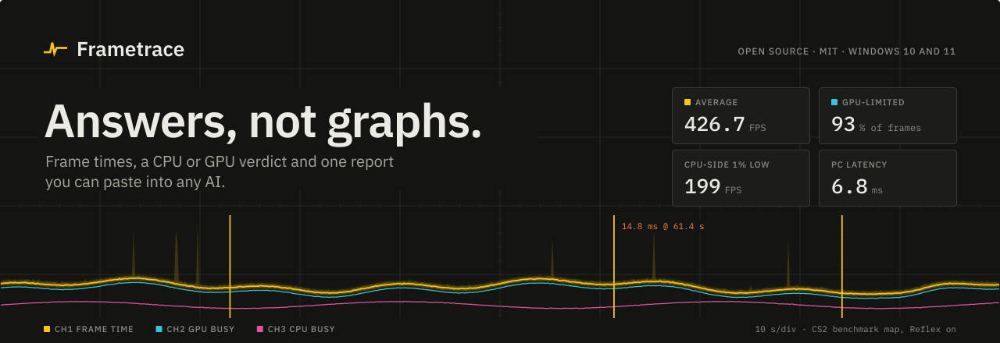
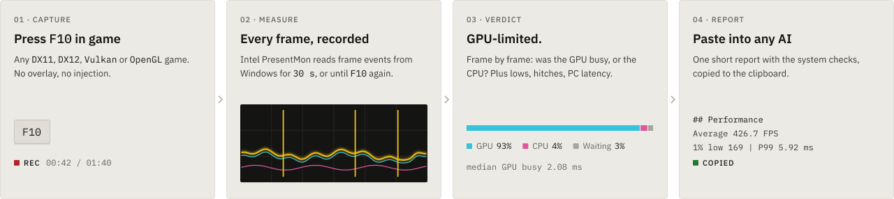

<p align="center">
  
</p>

<p align="center">
  <a href="https://github.com/melle62/frametrace/actions/workflows/ci.yml"></a>
  <a href="LICENSE"></a>
  
  
  
</p>

Pick what you want to improve: a higher average FPS, higher 1% lows, lower latency, less
stutter, or a target FPS at the best quality. Frametrace benchmarks the game while you play,
finds out which game it is and reads its current graphics settings, and writes one report that
is a ready-made prompt. Paste it into any AI and get the in-game settings to change for your
goal. Change them, run again, and the comparison tells you whether it helped and what to try next.

<table>
  <tr><td><b>Games</b></td><td>Any game PresentMon can see: <code>DX11</code>, <code>DX12</code>, <code>Vulkan</code>, <code>OpenGL</code>. Any engine, any launcher, no per-game setup.</td></tr>
  <tr><td><b>Capture</b></td><td>Intel <a href="https://github.com/GameTechDev/PresentMon">PresentMon</a> <code>2.6.0</code> reads frame events from Windows. No injection, no overlay.</td></tr>
  <tr><td><b>Accuracy</b></td><td>CS2 benchmark map: CPU-side 1% low within <code>1.5%</code> of the game's own VProf counter. Two runs of the same <code>100 s</code> came out <code>0.2%</code> apart.</td></tr>
  <tr><td><b>Overhead</b></td><td>CS2 ran <code>512.7</code> FPS while recording, <code>515.3</code> FPS in earlier runs without it.</td></tr>
</table>

> **Status: alpha.** Capture, analysis, goals, game detection, report and compare work. In-game
> settings are read for Source 2 (CS2), Unreal Engine and Unity games; for others the report asks
> the AI to get them from you. See the [roadmap](#roadmap).

<picture>
  <source media="(prefers-color-scheme: light)" srcset="docs/images/window-light.png">
  
</picture>

<sub>The window with synthetic demo data shaped like a CS2 benchmark run. It follows your GitHub
theme: dark by default, light in light mode.</sub>

## How it works

<picture>
  <source media="(prefers-color-scheme: dark)" srcset="docs/brand/how-it-works-dark.svg">
  
</picture>

Frametrace finds the game on its own: the window in front when you press the hotkey, or the
process that drew the most frames. It names the game from its Steam entry or the exe, and reads
the current graphics settings from the engine's config (Source 2 video config, Unreal
`GameUserSettings.ini`, Unity PlayerPrefs). Account names, IDs and paths are left out. One report
holds everything below, led by your goal and a task for the AI.

| Goal | Measured by |
|---|---|
| Higher average FPS | Average FPS, with the 1% low as a guard |
| Higher 1% lows | 1% low, 0.1% low, CPU-side 1% low |
| Lower latency | PC latency (NVIDIA Reflex games), else frame time, VSync and caps |
| Less stutter | Time in hitches, 0.1% low, worst frame |
| Hit a target FPS | Share of seconds at the target and the 1% low; headroom goes into quality |

| Readout | What it answers |
|---|---|
| Average FPS, 1% low, 0.1% low, worst second | How fast, and how even |
| CPU-side 1% low | The same low an in-game counter such as VProf shows |
| P99 frame time, hitches | The frames you feel. A hitch is `2x` its neighbours and `4 ms` longer. |
| GPU-limited / CPU-limited / waiting | What each frame waited for, and how fast the GPU alone could go |
| PC latency, median and P95 | Input to frame sent, in games with NVIDIA Reflex |
| Display path | API, present mode, VSync, tearing, frames never shown |
| Game | Name, Steam app and build, version, engine, graphics API |
| In-game settings | The game's current graphics settings, read from its config |
| System | CPU, GPU and driver, RAM speed vs. the kit's rating, board, BIOS, displays |

The bottleneck tells the AI which settings can move the frame rate in that scene: GPU-heavy
ones (resolution, upscaling, shadows) when the GPU limits, CPU-heavy ones (view distance,
crowds, physics) when the CPU does. Automatic checks flag what to fix before touching game settings: RAM below its rated speed
(EXPO/XMP off), single-channel RAM, a display below its maximum refresh rate, frames through the
desktop compositor, VSync, FPS caps, power plan, Game Mode, HAGS and memory integrity. Compare
mode lays two captures over each other, before and after a settings change: whether B is better
for your goal (outside run-to-run noise), which in-game settings changed, both frame-time traces
on one screen, every metric from A to B, and what changed in the system. Its text is a follow-up
prompt: keep the change or not, and what to try next.

## Use it (Windows 10/11)

You need Python `3.10` or newer. Nothing else: the window is plain tkinter and bundles its fonts.

```powershell
python -m frametrace              # or double-click Frametrace.bat
```

On first start the window offers to download PresentMon (Intel's free capture tool, checked
against a pinned SHA-256). Recording needs administrator rights or membership in the
"Performance Log Users" group, and the window offers both. Then:

1. Pick your goal in the window (and a target FPS for "Hit a target FPS"; empty uses your
   display's refresh rate).
2. Start a game, go to a repeatable scene (a benchmark mode, a replay, a fixed route) and press
   <kbd>F10</kbd> (change it in the window). You'll hear a beep.
3. Play normally. Recording stops after the chosen length (`30 s` by default), or when you press
   <kbd>F10</kbd> again in manual mode.
4. The result appears in the window, and the report is already on your clipboard. Paste it into
   any AI and ask away: it already says what you want and what to answer.
5. Change the 1–3 settings it suggests, capture the same scene again, select both captures and
   copy the comparison back into the same chat.

Captures are saved in `Documents\Frametrace\captures` and listed on the left, grouped by game.
<kbd>Ctrl</kbd>+click a second capture to compare the two. Right-click a capture to give it a label
(like "MSAA 2x", which the report and comparisons then carry), move it into a group of your own
(a test session, the setting you're tuning), open its folder, copy its report or delete it. Click
a group's heading to fold it; right-click it to rename the group or delete its captures. Deleted
captures go to the Recycle Bin.

| Keys | |
|---|---|
| <kbd>F10</kbd> | start or stop a capture, in any game, even fullscreen |
| <kbd>↑</kbd> <kbd>↓</kbd> | previous or next capture |
| <kbd>Ctrl</kbd>+<kbd>C</kbd> | copy the report (or the comparison) |
| <kbd>Ctrl</kbd>+<kbd>Tab</kbd> | next tab: Summary, Report, Game, System, Compare |
| <kbd>Ctrl</kbd>+<kbd>O</kbd> | open the capture's folder |
| <kbd>F2</kbd> | label the selected capture |
| <kbd>Delete</kbd> | delete the selected capture (asks first, goes to the Recycle Bin) |

Command line: `python -m frametrace report capture.csv` analyzes an existing PresentMon CSV,
and `python -m frametrace compare before after` compares two saved captures. Both take
`--goal avg_fps|lows|latency|stutter|target` and `--target 144`.

For PresentMon details (CSV formats, permissions, anti-cheat), see
[docs/presentmon.md](docs/presentmon.md).

## Repo layout

```
frametrace/          core package, game-agnostic (no game-specific code, ever)
  gui.py             the window (tkinter, bench-instrument design)
  theme.py           design tokens: colors, IBM Plex fonts, ttk styles
  instruments.py     scope, readouts, lamps, buttons drawn with plain tk widgets
  summary.py         wording of the summary view (verdict, readouts, details, goal verdict)
  goals.py           tuning goals: what each one measures and asks the AI for
  game.py            which game: Steam manifest, exe version info, engine
  gamesettings.py    current in-game settings from engine configs, personal data filtered
  trace.py           compact frame-time trace for the scope (trace.json)
  capture.py         recording controller: PresentMon start/stop, game pick, saving
  hotkey.py          global hotkey (RegisterHotKey)
  analyze.py         frame stats + CPU/GPU bottleneck
  sysinfo.py         CPU/GPU/RAM/BIOS/display/Windows settings
  report.py          the report as an AI prompt, checks, JSON result, compare mode
  columns.py         PresentMon CSV schema detection → canonical column names
  process.py         foreground process + automatic game detection
  presentmon.py      locating and driving PresentMon
  download.py        PresentMon download with hash check
  assets/            window icon; fonts/: IBM Plex Sans and Mono (SIL OFL 1.1)
design/              the Frametrace design system (hue skill: tokens, components, previews)
skills/              AI skills: a general one, one per tested game (CS2), the template
tools/               setup, probe, icon and README image scripts (brand.py, window_shots.py)
tests/               pytest suite and fixtures
docs/                design notes, findings, README images (docs/brand)
bin/                 PresentMon goes here (not committed)
```

## Roadmap

- [x] Repo, license, sponsor button
- [x] PresentMon version, CSV schemas, permissions, game auto-detection design
- [x] Window with hotkey capture, fixed or manual length
- [x] Stats, bottleneck detection, system info, checks, report, compare
- [x] Brand and window redesign ([design system](design/frametrace-design/SKILL.md))
- [x] Goal-driven reports: goal picker, game name, in-game settings, follow-up comparisons
- [ ] Check the settings readers on real installs (CS2, an Unreal game, a Unity game)
- [ ] More engine readers (Frostbite, RE Engine, id Tech, Creation Engine)
- [ ] Real captures across DX11 / DX12 / Vulkan / OpenGL to calibrate thresholds
- [x] Skills: a general one with game studies, and a CS2 skill ([skills](skills/README.md))
- [ ] Game skills for DayZ, Forza Horizon 6 and more, from game studies
- [ ] Skills tested with real reports in several AIs
- [ ] Packaged `.exe` release

## Design

Frametrace looks like a bench instrument: warm graphite panels, one yellow trace, cyan for the
GPU, magenta for the CPU, IBM Plex Sans for words and IBM Plex Mono for every number. The design
system lives in [design/frametrace-design](design/frametrace-design/SKILL.md), generated with the
[hue](https://github.com/dominikmartn/hue) skill from one `design-model.yaml`. Open
`preview.html`, `component-library.html`, `landing-page.html` or `app-screen.html` there to see
it in both modes.

## Contributing

The most valuable contributions don't need any Python:

- **Probe results** from games and APIs we haven't covered yet
- **Game skills:** study a game with the general skill (settings map, a repeatable scene,
  measured costs) and send the skill it drafts

See [CONTRIBUTING.md](CONTRIBUTING.md).

## Support

Frametrace is free and MIT-licensed. If it saved you time, you can
[sponsor the project](https://github.com/sponsors/melle62).

## License

[MIT](LICENSE). PresentMon is © Intel Corporation, MIT-licensed. See
[THIRD_PARTY_NOTICES.md](THIRD_PARTY_NOTICES.md).
