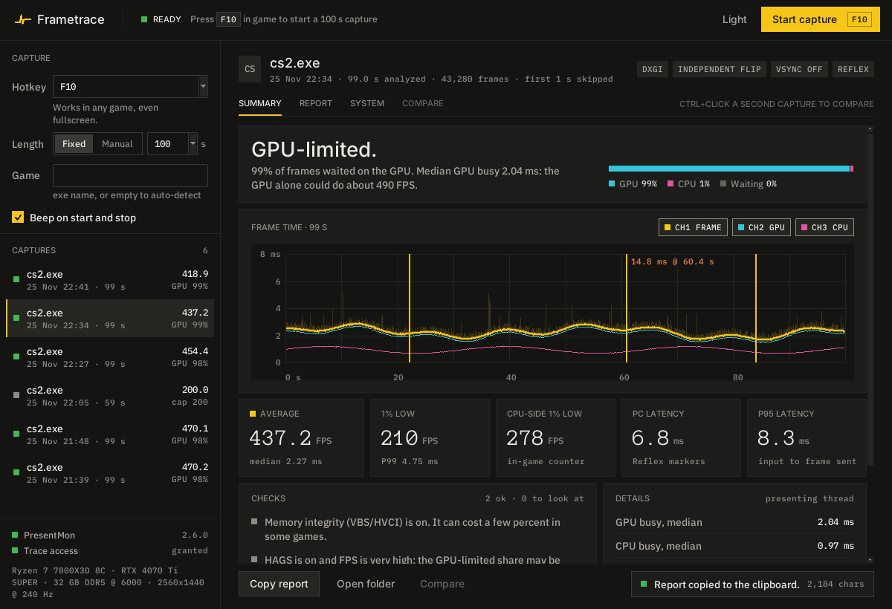

# Frametrace

**Answers instead of graphs.** Frametrace records frame times while you play, works out whether
your CPU or your GPU is holding you back, collects the system details that matter, and gives you
one compact text report. Paste the report into any AI. With the Frametrace skill, it turns into
concrete advice for your game and your hardware.

Works with **any** game: DirectX 11, DirectX 12, Vulkan and OpenGL, any engine, any launcher. No
per-game setup. Capture is based on Intel's [PresentMon](https://github.com/GameTechDev/PresentMon),
which reads frame events from Windows and doesn't touch the game.

> **Status: alpha.** Capture, analysis, system info, report and compare work. Thresholds for the
> CPU/GPU split are still being calibrated with real captures. See the [roadmap](#roadmap).



<sub>The window with synthetic demo data shaped like a CS2 benchmark run. Light mode:
[docs/images/window-light.png](docs/images/window-light.png).</sub>

## How it works

```
F10 in game ──► PresentMon records every frame ──► F10 again (or after 30 s)
                                                     │
          ┌──────────────────────────────────────────┘
          ▼
  pick the game automatically ──► stats + CPU/GPU bottleneck ──► + system info + checks
                                                                     │
                       report copied to clipboard ◄──────────────────┘
                                 │
                                 ▼
                 paste into Claude / ChatGPT / … with the Frametrace skill
```

The report covers average FPS, 1% and 0.1% lows, the worst second, P99 frame time, stutter
spikes, the share of frames limited by the CPU and by the GPU, how fast the GPU alone could go,
and PC latency when the game uses NVIDIA Reflex. Automatic checks catch the classic problems: RAM running below its rated speed
(EXPO/XMP off), single-channel RAM, a display running below its maximum refresh rate, frames
going through the desktop compositor, VSync, FPS caps, and power plan, Game Mode, HAGS and
memory integrity. Compare mode puts two captures side by side (before and after an upgrade
or a settings change).

## Use it (Windows 10/11)

You need Python 3.10 or newer.

```powershell
python -m frametrace              # or double-click Frametrace.bat
```

No extra packages: the window is plain tkinter and bundles its fonts.

On first start the window offers to download PresentMon (Intel's free capture tool, checked
against a pinned SHA-256). Recording needs administrator rights or membership in the
"Performance Log Users" group, and the window offers both. Then:

1. Start a game and press **F10** (change it in the window). You'll hear a beep.
2. Play normally. Recording stops after the chosen length (30 s by default), or when you press
   F10 again in manual mode.
3. The verdict, the frame-time scope and the readouts appear in the window, and the report is
   already on your clipboard. Paste it into any AI.

Captures are saved in `Documents\Frametrace\captures` and listed on the left. Ctrl+click a
second capture to compare the two.

Command line: `python -m frametrace report capture.csv` analyzes an existing PresentMon CSV,
and `python -m frametrace compare before after` compares two saved captures.

For PresentMon details (CSV formats, permissions, anti-cheat), see
[docs/presentmon.md](docs/presentmon.md).

## Repo layout

```
frametrace/          core package, game-agnostic (no game-specific code, ever)
  gui.py             the window (tkinter, bench-instrument design)
  theme.py           design tokens: colors, IBM Plex fonts, ttk styles
  instruments.py     scope, readouts, lamps, buttons drawn with plain tk widgets
  summary.py         wording of the summary view (verdict, readouts, details)
  trace.py           compact frame-time trace for the scope (trace.json)
  capture.py         recording controller: PresentMon start/stop, game pick, saving
  hotkey.py          global hotkey (RegisterHotKey)
  analyze.py         frame stats + CPU/GPU bottleneck
  sysinfo.py         CPU/GPU/RAM/BIOS/display/Windows settings
  report.py          text report, checks, JSON result, compare mode
  columns.py         PresentMon CSV schema detection → canonical column names
  process.py         foreground process + automatic game detection
  presentmon.py      locating and driving PresentMon
  download.py        PresentMon download with hash check
  assets/fonts/      IBM Plex Sans and Mono (SIL OFL 1.1)
design/              the Frametrace design system (hue skill: tokens, components, previews)
skill/               the AI skill (SKILL.md) and optional per-game profiles
tools/               setup and probe scripts
tests/               pytest suite and fixtures
docs/                design notes and findings
bin/                 PresentMon goes here (not committed)
```

## Roadmap

- [x] Repo, license, sponsor button
- [x] PresentMon version, CSV schemas, permissions, game auto-detection design
- [x] Window with hotkey capture, fixed or manual length
- [x] Stats, bottleneck detection, system info, checks, report, compare
- [x] Brand and window redesign ([design system](design/frametrace-design/SKILL.md))
- [ ] Real captures across DX11 / DX12 / Vulkan / OpenGL to calibrate thresholds
- [ ] Skill (`skill/SKILL.md`) tested with real reports
- [ ] Packaged `.exe` release

## Design

Frametrace looks like a bench instrument: warm graphite panels, one yellow trace, cyan for the
GPU, magenta for the CPU, IBM Plex Sans for words and IBM Plex Mono for every number. The design
system lives in [design/frametrace-design](design/frametrace-design/SKILL.md), generated with the
[hue](https://github.com/dominikmartn/hue) skill from one `design-model.yaml`. Open
`preview.html`, `component-library.html`, `landing-page.html` or `app-screen.html` there to see
it in both modes.

## Contributing

The most valuable contributions don't need any Python:

- **Probe results** from games and APIs we haven't covered yet
- **Game profiles** for the skill: known CPU-heavy settings, engine quirks, built-in benchmarks

See [CONTRIBUTING.md](CONTRIBUTING.md).

## Support

Frametrace is free and MIT-licensed. If it saved you time, you can
[sponsor the project](https://github.com/sponsors/melle62).

## License

[MIT](LICENSE). PresentMon is © Intel Corporation, MIT-licensed. See
[THIRD_PARTY_NOTICES.md](THIRD_PARTY_NOTICES.md).
